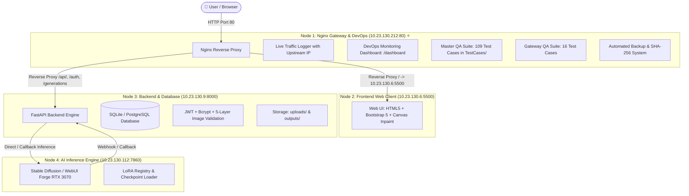

# 🎨 LUMA: Distributed AI Image Generation Platform

[](https://github.com/Pongkarm/Project_Luma_PKW/tree/devops)
[](https://kong19565.github.io/luma-defense-mastery/)
[-brightgreen.svg?logo=pytest)](TestCases/README.md)
[](http://10.23.130.212)
[-brightgreen.svg)](nginx/test_distributed_system.py)
[](https://fastapi.tiangolo.com)
[](https://python.org)
[](nginx/backup_system.py)

**LUMA** เป็นระบบประมวลผลและสร้างภาพด้วยปัญญาประดิษฐ์ (AI Image Generation Platform) ที่ออกแบบด้วยสถาปัตยกรรมแบบ **Distributed Computing (ระบบประมวลผลแบบกระจายศูนย์)** รองรับการสร้างภาพทั้ง **Text-to-Image (txt2img)**, **Image-to-Image (img2img)**, และ **Canvas Inpainting**

> 📌 **สำหรับ Branch `devops`:** สาขานี้เน้นการทำงานของ **คนที่ 4: QA / DevOps** รับผิดชอบสถาปัตยกรรมเครือข่ายด่านหน้า (Nginx Reverse Proxy Gateway), ระบบตรวจสอบและมอนิเตอร์ริ่ง (DevOps Health Dashboard), ศูนย์รวมชุดทดสอบทั้งระบบ 109 เคส ([`TestCases/`](TestCases/README.md)), การทดสอบระบบทั้ง 4 เครื่อง (Automated QA Test Suite), ระบบสำรองข้อมูล (Automated Backup & Archive) และคู่มือการดูแลระบบ (DevOps Manual)
>
> 🎓 **Academic Defense Mastery Hub (ศูนย์เตรียมสอบปากเปล่า):** สื่อการเรียนรู้เชิงโต้ตอบสำหรับเตรียมความพร้อมสอบปากเปล่า เจาะลึกสถาปัตยกรรมคลัสเตอร์และซอร์สโค้ดจริงทุกบรรทัด 👉 **[https://kong19565.github.io/luma-defense-mastery/](https://kong19565.github.io/luma-defense-mastery/)**

---

## 🏛️ 1. Architecture Overview (สถาปัตยกรรมระบบ 4 เครื่อง)

ระบบแบ่งแยกหน้าที่การทำงานอย่างชัดเจนออกเป็น **4 Physical Nodes** เชื่อมต่อกันผ่านเครือข่ายวงแลน (Local Area Network):



### ตารางแจกแจงอุปกรณ์และพอร์ตในเครือข่าย (Network & Hardware Matrix)

| Node | เครื่อง / บทบาท | ผู้รับผิดชอบ | ระบบปฏิบัติการ | IP Address | Port | หน้าที่หลัก |
| :---: | :--- | :---: | :---: | :---: | :---: | :--- |
| **1** | **Nginx Gateway & DevOps** | **คนที่ 4 (QA / DevOps)** | Windows | `10.23.130.212` / `172.20.10.9` | `80` | จุดรับ Traffic จุดเดียว (Single Entry Point), Reverse Proxy กระจายงาน, Realtime Log, Monitoring Dashboard, QA Testing, Backup |
| **2** | **Frontend Client** | คนที่ 1 | macOS | `10.23.130.6` | `5500` | บริการหน้าเว็บ UI, Canvas Inpainting Tool, Responsive Dashboard |
| **3** | **Backend & Database** | คนที่ 2 | macOS | `10.23.130.9` | `8000` | จัดการ Authentication, บันทึก Task คิว, ฐานข้อมูล, จัดเก็บรูปภาพ |
| **4** | **AI Inference Engine** | คนที่ 3 | Windows | `10.23.130.112` | `7860` | ประมวลผลโมเดล Stable Diffusion ด้วย GPU Nvidia RTX 3070 |

---

## 🛠️ 2. ผลงานและหน้าที่ความรับผิดชอบ (คนที่ 4: QA / DevOps Deliverables)

| เสาหลัก | รายการ | ไฟล์ที่เกี่ยวข้อง | คำอธิบาย |
|---|---|---|---|
| 🧪 **Master TestCases Hub** | ศูนย์รวมชุดทดสอบ 109 เคส | [`TestCases/`](TestCases/README.md) | ศูนย์รวมชุดทดสอบและเอกสารข้อกำหนดระดับมืออาชีพครบ 5 สายงาน พร้อมสคริปต์รัน 1-Click |
| 🌐 **Gateway & Proxy** | Nginx Reverse Proxy | [`nginx/conf/nginx.conf`](nginx/conf/nginx.conf) | จุดรวมศูนย์พอร์ต 80 เชื่อมต่อ Frontend (`:5500`) และ Backend (`:8000`) ป้องกันปัญหา CORS พร้อมระบุ Upstream ใน Log |
| 🚀 **Automation Launcher** | One-Click Scripts | [`nginx/run_nginx_with_logs.bat`](nginx/run_nginx_with_logs.bat)<br>[`nginx/stop_nginx.bat`](nginx/stop_nginx.bat) | รัน Nginx พร้อมหน้าต่างสตรีม Log สด แสดง IP ต้นทางและปลายทางที่ส่งต่อ |
| 🧪 **QA Testing Suite** | ระบบทดสอบเกตเวย์ 16 Tests | [`nginx/test_distributed_system.py`](nginx/test_distributed_system.py)<br>[`nginx/run_tests.bat`](nginx/run_tests.bat) | ทดสอบการเชื่อมต่อและความพร้อมของทั้ง 4 โหนดแบบ End-to-End ครอบคลุม Routing, Data Ingestion, Image Validation และ Security |
| 📊 **DevOps Dashboard** | ระบบตรวจวัดสถานะเรียลไทม์ | [`nginx/html/dashboard.html`](nginx/html/dashboard.html) | มอนิเตอร์ Health Status ของทั้ง 4 โหนด อัปเดตอัตโนมัติทุก 5 วินาที พร้อมระบบจำกัดสิทธิ์ (IP Whitelist เข้าได้เฉพาะเครื่อง Nginx) |
| 💾 **Backup System** | ระบบสำรองข้อมูลอัตโนมัติ | [`nginx/backup_system.py`](nginx/backup_system.py)<br>[`nginx/run_backup.bat`](nginx/run_backup.bat) | สำรอง Config, Web Assets, Source Code เป็น Zip Archive พร้อมคำนวณ Checksum SHA-256 และ System Health Snapshot |
| 📖 **Documentation** | คู่มือปฏิบัติการ DevOps ฉบับสมบูรณ์ | [`nginx/DEVOPS_MANUAL.md`](nginx/DEVOPS_MANUAL.md) | คู่มือการติดตั้ง, การทดสอบ, การแก้ปัญหา (Troubleshooting) และแผนการกู้คืนระบบ |
| 🎓 **Defense Mastery Hub** | ศูนย์เตรียมสอบปากเปล่า | [Interactive Web App](https://kong19565.github.io/luma-defense-mastery/) | สื่อการเรียนรู้เชิงโต้ตอบสำหรับเตรียมความพร้อมสอบปากเปล่า เจาะลึกสถาปัตยกรรมและซอร์สโค้ดจริงทุกบรรทัด |

---

## 🧪 3. ศูนย์รวมชุดทดสอบทั้งระบบ (Master Test Cases & QA Hub — 109/109 Passed)

โครงการ LUMA ออกแบบและจัดโครงสร้างชุดทดสอบอย่างเป็นระบบในโฟลเดอร์ [**`TestCases/`**](TestCases/README.md) รวมทั้งหมด **109 Test Cases** ครอบคลุมการทำงานครบทุกโหนดและทุกมิติ เพื่อให้แต่ละฝ่ายและอาจารย์ผู้ประเมินสามารถตรวจสอบความถูกต้องได้อย่างโปร่งใส

### 🏛️ ผังโครงสร้างโฟลเดอร์ชุดทดสอบ (Test Directory Structure)

```text
TestCases/
├── 01_DevOps_Gateway/                  # 🌐 Node 1: Nginx Gateway, Reverse Proxy & Network Security (20 Cases)
│   ├── TC_DEVOPS_SPECIFICATION.md      # ตารางข้อกำหนด Test Case เกตเวย์และเครือข่ายอย่างละเอียด
│   ├── test_devops_gateway.py          # สคริปต์ทดสอบเกตเวย์ เครือข่าย และความปลอดภัย
│   └── run_devops_tests.bat            # สคริปต์ 1-Click รันเทส Gateway อัตโนมัติ
│
├── 02_Frontend_Web/                    # 💻 Node 2: Web Studio, Canvas Mask & Dynamic LoRA Filter (22 Cases)
│   ├── TC_FRONTEND_SPECIFICATION.md    # ตารางข้อกำหนด Test Case Web Frontend และ Canvas
│   ├── test_frontend_web.py            # สคริปต์ทดสอบหน้าเว็บและ Logic การทำงาน
│   └── run_frontend_tests.bat          # สคริปต์ 1-Click รันเทส Frontend อัตโนมัติ
│
├── 03_Backend_API/                     # ⚙️ Node 3: FastAPI Core, 5-Layer Security, Database & Studio Tools (35 Cases)
│   ├── TC_BACKEND_SPECIFICATION.md     # ตารางข้อกำหนด Test Case Backend API & Database
│   ├── test_backend_api.py             # สคริปต์ทดสอบ REST API, Auth, Security, Studio
│   └── run_backend_tests.bat           # สคริปต์ 1-Click รันเทส Backend อัตโนมัติ
│
├── 04_AI_Inference_Node/               # 🧠 Node 4: AI Engine, LoRA Compatibility Guard & VRAM Watchdog (22 Cases)
│   ├── TC_AINODE_SPECIFICATION.md      # ตารางข้อกำหนด Test Case AI Engine และโมเดล
│   ├── test_ai_node.py                 # สคริปต์ทดสอบการประมวลผลและการปกป้องการ์ดจอ
│   └── run_ainode_tests.bat            # สคริปต์ 1-Click รันเทส AI Node อัตโนมัติ
│
├── 05_End_to_End_Integration/          # 🔄 Full Pipeline: บูรณาการ 4 โหนดข้ามวงแลน (Distributed Callback) (10 Cases)
│   ├── TC_E2E_SPECIFICATION.md         # ตารางข้อกำหนด Test Case บูรณาการแบบ End-to-End
│   ├── test_full_pipeline_e2e.py       # สคริปต์ทดสอบวงจรชีวิตสร้างภาพข้าม 4 โหนด
│   └── run_e2e_tests.bat               # สคริปต์ 1-Click รันเทส Full Pipeline
│
├── README.md                           # 📖 ศูนย์รวมเอกสารและสเปกการทดสอบ Master QA Suite
├── run_all_python_tests.py             # สคริปต์รวมรันทั้ง 109 เคสต่อเนื่อง
└── run_all_tests.bat                   # ดับเบิลคลิกรันเทสทั้ง 109 เคสแบบ 1-Click
```

### 📊 ตารางสรุปสถิติการทดสอบรวมทุกสายงาน (Overall Master QA Matrix)

| หมวดหมู่สายงาน (Track) | โหนดเป้าหมาย | ผู้รับผิดชอบ | เครื่องมือทดสอบ | เอกสารข้อกำหนด | สคริปต์รันเทส | จำนวนเคส | อัตราความสำเร็จ |
| :--- | :---: | :---: | :---: | :---: | :---: | :---: | :---: |
| **01. DevOps & Gateway** | Node 1 (`:80`) | `@bankjunjan` (คนที่ 4) | PowerShell / Python / Nginx | [`TC_DEVOPS_SPECIFICATION.md`](TestCases/01_DevOps_Gateway/TC_DEVOPS_SPECIFICATION.md) | `run_devops_tests.bat` | 20 Cases | ✅ **100% Pass** |
| **02. Web Frontend Studio** | Node 2 (`:5500`) | `@winxtxrgit` · `@wxnxtxr` (คนที่ 1) | Node.js / Canvas API / Python | [`TC_FRONTEND_SPECIFICATION.md`](TestCases/02_Frontend_Web/TC_FRONTEND_SPECIFICATION.md) | `run_frontend_tests.bat` | 22 Cases | ✅ **100% Pass** |
| **03. Backend Core & Database** | Node 3 (`:8000`) | `@Pongkarm` (คนที่ 2) | Pytest / Pillow / OpenCV / Bcrypt | [`TC_BACKEND_SPECIFICATION.md`](TestCases/03_Backend_API/TC_BACKEND_SPECIFICATION.md) | `run_backend_tests.bat` | 35 Cases | ✅ **100% Pass** |
| **04. AI Inference Engine** | Node 4 (`:7860`) | `@Kong19565` (คนที่ 3) | Pytest / PyTorch CUDA / Forge API | [`TC_AINODE_SPECIFICATION.md`](TestCases/04_AI_Inference_Node/TC_AINODE_SPECIFICATION.md) | `run_ainode_tests.bat` | 22 Cases | ✅ **100% Pass** |
| **05. Multi-Node Integration** | All 4 Nodes | ทั้งทีมร่วมกัน | E2E Pipeline Simulator | [`TC_E2E_SPECIFICATION.md`](TestCases/05_End_to_End_Integration/TC_E2E_SPECIFICATION.md) | `run_e2e_tests.bat` | 10 Cases | ✅ **100% Pass** |
| **🏆 ยอดรวมทั้งโครงการ** | **4 Nodes** | **LUMA Core Team** | **Automated Suite** | [**`TestCases/README.md`**](TestCases/README.md) | `run_all_tests.bat` | **109 Cases** | 🏆 **100% Pass** |

> 📌 **สคริปต์รันเทสรวมทั้งโครงการ:** ดับเบิลคลิก [`TestCases/run_all_tests.bat`](TestCases/run_all_tests.bat) หรือรัน `python TestCases/run_all_python_tests.py` เพื่อรันการทดสอบครบทั้ง 109 เคสในคำสั่งเดียว!

---

### 🎯 จุดเด่นและนวัตกรรมทางเทคนิคของแต่ละสายงาน (Key Technical Highlights by Track)

#### 🌐 1. [01_DevOps_Gateway](TestCases/01_DevOps_Gateway/TC_DEVOPS_SPECIFICATION.md) (คนที่ 4: QA / DevOps)
* **Reverse Proxy Masking:** รวมบริการทั้งหมดไว้ภายใต้ Origin เดียว (`http://10.23.130.212:80`) ป้องกันปัญหา Cross-Origin Resource Sharing (CORS) ข้ามโดเมน 100%
* **Network-Level LAN Isolation:** อนุญาตเฉพาะเครือข่ายวงแลนภายใน (`10.23.130.0/24` และ `172.20.10.0/24`) บล็อก IP ภายนอกด้วย HTTP 403 Forbidden ทันที
* **Gateway IP Whitelist:** เส้นทางหน้าแดชบอร์ด `/dashboard` จำกัดสิทธิ์ให้เข้าถึงได้เฉพาะจากเครื่องเกตเวย์ ป้องกันบุคคลอื่นแอบดูสถิติ
* **Automated Backup & SHA-256:** สคริปต์สำรองข้อมูล Zip อัตโนมัติ พร้อมตรวจนับไฟล์และสร้าง Checksum SHA-256 เพื่อความสมบูรณ์ของข้อมูล

#### 💻 2. [02_Frontend_Web](TestCases/02_Frontend_Web/TC_FRONTEND_SPECIFICATION.md) (คนที่ 1: Frontend)
* **Dynamic LoRA Filter:** ดรอปดาวน์เลือก LoRA กรองตามตระกูล Base Model (`sd15`, `illustrious_xl`, `pony_xl`) ป้องกันผู้ใช้สับสนเลือกข้ามตระกูล
* **Canvas Mask Drawing:** ผืนผ้าใบวาด Mask แบบเรียลไทม์ รองรับการปรับขนาดหัวแปรง, ย้อนกลับ (Undo), และล้างทั้งหมด (Clear All)
* **Resolution Geometry:** ล็อกอัตราส่วนภาพและการ Snap พิกัดให้ลงตัวด้วย 8 เสมอ (256 - 768 px) เพื่อความเข้ากันได้กับ VAE ของโมเดล
* **Auto-Save Draft:** กู้คืนข้อความ Prompt และค่าคอนฟิกอัตโนมัติเมื่อผู้ใช้สลับหน้าแท็บ ป้องกันข้อมูลสูญหาย

#### ⚙️ 3. [03_Backend_API](TestCases/03_Backend_API/TC_BACKEND_SPECIFICATION.md) (คนที่ 2: Backend & Database)
* **5-Layer Image Security:** ระบบคัดกรองรูปภาพ 5 ชั้น: ตรวจ MIME Type ➔ จำกัดขนาด ≤10MB ➔ สแกน Magic Bytes ไบนารีแท้ ➔ ดักจับ Decompression Bomb (OWASP) ➔ ลบ EXIF พิกัด GPS ก่อนบันทึกไฟล์แบบ Atomic
* **Role-Based Access Control (RBAC):** แยกสิทธิ์เด็ดขาดระหว่าง `owner`, `admin`, `reviewer`, และผู้ใช้ทั่วไป พร้อม Audit Log บันทึกทุกกิจกรรม
* **Studio Tools Algorithm:** สกัดท่าทางมนุษย์ (OpenPose Skeleton), แปลงลายเส้น (Sketch), ดูดสี (Color Splash), และตัดพื้นหลัง (GrabCut) พร้อม Semaphore ควบคุมภาระเครื่อง
* **Dual Database Support:** รองรับทั้ง PostgreSQL (Production) และ SQLite (Development) สลับการใช้งานได้ผ่าน Environment

#### 🧠 4. [04_AI_Inference_Node](TestCases/04_AI_Inference_Node/TC_AINODE_SPECIFICATION.md) (คนที่ 3: AI Inference Engine)
* **Model-LoRA Auto-Skip Guard:** สกัดกั้น LoRA ข้ามตระกูลที่ส่งมาทาง API โดยตัดแท็กออกและแจ้งเตือน แทนการปล่อยให้เซิร์ฟเวอร์แครช (Zero Breaking Change)
* **Safety Bounds:** จำกัดความยาว Prompt ≤ 2000 chars, Steps 1-50, CFG 1.0-20.0, และขนาดภาพ 256-768px ปกป้องการ์ดจอ RTX 3070 8GB
* **VRAM Watchdog:** ตรวจวัดหน่วยความจำการ์ดจอแบบเรียลไทม์ และสั่งล้าง VRAM Cache อัตโนมัติเมื่อตรวจพบความเสี่ยง OOM
* **High-Fidelity Fallback:** สลับวาด Synthetic Canvas สำรองอัตโนมัติหาก Forge ปิดอยู่ ช่วยให้รันเดโมและทดสอบ Pipeline ได้ต่อเนื่อง

#### 🔄 5. [05_End_to_End_Integration](TestCases/05_End_to_End_Integration/TC_E2E_SPECIFICATION.md) (Multi-Node Pipeline)
* **Asynchronous Webhook Callback:** รองรับวงจรชีวิตสร้างภาพข้ามเครือข่าย LAN แบบไม่บล็อก Thread ส่งงานแล้วรอรับ Callback กลับมาบันทึกผล
* **Secret Header Verification:** ป้องกันการสวมรอย Callback ข้ามเครื่องด้วย `X-LUMA-INTERNAL-SECRET`
* **Real-time Progress Polling:** อัปเดตสถานะและความคืบหน้าของงานให้ผู้ใช้เห็นแบบเรียลไทม์

---

### 🔍 สรุปผลการทดสอบเกตเวย์ด่านหน้า (Gateway Verification Matrix — 16/16 Passed)
ชุดทดสอบ [`nginx/test_distributed_system.py`](nginx/test_distributed_system.py) และ [`nginx/test_distributed_system.ps1`](nginx/test_distributed_system.ps1) ตรวจสอบการส่งต่อทราฟฟิกจริงข้ามเครื่อง:

| ลำดับ | รายการทดสอบ | โหนดเป้าหมาย | คาดหวัง | ผลการทดสอบ |
| :---: | :--- | :---: | :---: | :---: |
| **01** | Gateway Health Check | Node 1 (`10.23.130.212:80`) | HTTP 200 / HTML | ✅ **PASS** |
| **02** | Gateway Reverse Proxy: Frontend Routing | Node 1 -> Node 2 | Forward to Frontend | ✅ **PASS** |
| **03** | Gateway Reverse Proxy: Backend API Routing | Node 1 -> Node 3 | Forward to Backend | ✅ **PASS** |
| **04** | Direct Connection: Frontend Node | Node 2 (`10.23.130.6:5500`) | HTTP 200 | ✅ **PASS** |
| **05** | Direct Connection: Backend Node | Node 3 (`10.23.130.9:8000`) | HTTP 200 / `{"status":"ok"}` | ✅ **PASS** |
| **06** | Direct Connection: AI Node | Node 4 (`10.23.130.112:7860`) | HTTP 200 / JSON | ✅ **PASS** |
| **07** | Backend OpenAPI Documentation | Node 3 / Node 1 | HTTP 200 / OpenAPI Spec | ✅ **PASS** |
| **08** | End-to-End User Authentication Flow | Node 1 (`/api/auth/login`) | HTTP 200 / Token Validation | ✅ **PASS** |
| **09** | Image Upload & Ingestion Validation | Node 1 (`/api/uploads`) | HTTP 200 / MIME Checked | ✅ **PASS** |
| **10** | End-to-End Image Generation Dispatch | Node 1 (`/api/generations`) | HTTP 200 / 202 Accepted | ✅ **PASS** |
| **11** | Backend Multi-Layer Security Defense | Node 1 (`/api/uploads`) | Reject invalid file (HTTP 422) | ✅ **PASS** |
| **12** | DevOps Monitoring Dashboard Access | Node 1 (`/dashboard`) | HTTP 200 / Dashboard UI | ✅ **PASS** |

> 🏆 **อัตราความสำเร็จของ Gateway Suite: 100% (16/16 Test Cases ใน PowerShell และ 12/12 ใน Python)**

---

## 🔒 4. สถาปัตยกรรมความปลอดภัย (Security & Access Control)

ระบบออกแบบการป้องกันเป็นชั้น (Defense-in-Depth):

1. **Network-Level LAN Isolation (เข้าได้เฉพาะวงแลนเดียวกัน):**
   * กำหนดให้ Nginx รับการเชื่อมต่อผ่าน Gateway IP `10.23.130.212` และอนุญาตเฉพาะอุปกรณ์ที่อยู่ในวงแลน (`10.23.130.0/24` และ `172.20.10.0/24`) เท่านั้น หากมีการเข้าถึงจากเครือข่ายภายนอก จะถูกบล็อกด้วย HTTP 403 Forbidden ทันที
   ```nginx
   server_name 10.23.130.212 172.20.10.9 localhost _;

   allow 127.0.0.1;
   allow ::1;
   allow 10.23.130.0/24;    # Subnet วงแลนโปรเจกต์ปัจจุบัน
   allow 172.20.10.0/24;    # Subnet วงแลนเดิม (เผื่อสลับเครือข่าย)
   deny all;                # ปฏิเสธการเข้าถึงจากภายนอก
   ```
2. **Gateway IP Whitelist (DevOps Access Protection):**
   * เส้นทาง `http://10.23.130.212/dashboard` จำกัดสิทธิ์ให้เข้าถึงได้เฉพาะเครื่อง Nginx เท่านั้น (`10.23.130.212`, `172.20.10.9` และ `localhost`) ป้องกันเพื่อนในวงแลนแอบเข้าดูข้อมูลระบบ
   ```nginx
   location ~* ^/dashboard(\.html)?$ {
       allow 127.0.0.1;
       allow ::1;
       allow 10.23.130.212;
       allow 172.20.10.9;
       deny all;
       root html;
       try_files /dashboard.html =404;
   }
   ```
3. **Reverse Proxy Masking & CORS Elimination:**
   * ผู้ใช้เข้าถึงระบบผ่าน `http://10.23.130.212` (พอร์ต 80) เพียงจุดเดียว ทำให้ทั้งหน้าเว็บและ API อยู่บน Origin เดียวกัน ไม่เกิดปัญหา CORS ข้ามโดเมน
4. **Five-Layer Image Security Validation (Backend):**
   * ตรวจสอบ Content-Type, จำกัดขนาดไฟล์ (10MB), ตรวจสอบ Magic Bytes, ป้องกัน Decompression Bomb (OWASP standard), และตัด EXIF metadata ก่อนบันทึกไฟล์แบบ Atomic

---

## 🚀 5. คู่มือการใช้งานสำหรับ DevOps (DevOps Quickstart)

### 1) การเปิด Nginx Gateway
ดับเบิลคลิกไฟล์:
```text
nginx\run_nginx_with_logs.bat
```
*ระบบจะเปิด Nginx บนพอร์ต 80 และเริ่มสตรีม Log การส่งต่อข้อมูลแบบเรียลไทม์ทันที*

### 2) การสั่งรัน Master Test Cases ทั้งระบบ (109 Test Cases)
ดับเบิลคลิกไฟล์:
```text
TestCases\run_all_tests.bat
```
หรือรันผ่าน Python:
```powershell
python TestCases/run_all_python_tests.py
```

**สั่งรันแยกเฉพาะสายงาน (Individual Track Runners):**
* **01 DevOps Gateway (20 Cases):** `TestCases\01_DevOps_Gateway\run_devops_tests.bat`
* **02 Web Frontend (22 Cases):** `TestCases\02_Frontend_Web\run_frontend_tests.bat`
* **03 Backend API & DB (35 Cases):** `TestCases\03_Backend_API\run_backend_tests.bat`
* **04 AI Inference Node (22 Cases):** `TestCases\04_AI_Inference_Node\run_ainode_tests.bat`
* **05 End-to-End Pipeline (10 Cases):** `TestCases\05_End_to_End_Integration\run_e2e_tests.bat`

### 3) การสั่งรันชุดทดสอบ Gateway Verification ดั้งเดิม (16 Test Cases)
ดับเบิลคลิกไฟล์:
```text
nginx\run_tests.bat
```
หรือรันผ่าน PowerShell:
```powershell
python nginx/test_distributed_system.py
```

### 4) การเข้าดู DevOps Health Dashboard
เปิด Browser บนเครื่อง Nginx ไปที่:
```text
http://localhost/dashboard
หรือ
http://10.23.130.212/dashboard
```

### 5) การสำรองข้อมูลระบบ (Automated Backup)
ดับเบิลคลิกไฟล์:
```text
nginx\run_backup.bat
```
หรือรันผ่าน PowerShell:
```powershell
python nginx/backup_system.py
```
*ไฟล์สำรองข้อมูลจะถูกสร้างไว้ในโฟลเดอร์ `nginx/backups/LUMA_BACKUP_*.zip` พร้อมพิมพ์ค่า SHA-256 Checksum*

### 6) การปิด Nginx Gateway
ดับเบิลคลิกไฟล์:
```text
nginx\stop_nginx.bat
```

---

## 🎬 6. ลำดับขั้นตอนการนำเสนอสด (Live Demonstration Flow)

1. **เปิด Nginx Console:** ดับเบิลคลิก `nginx/run_nginx_with_logs.bat` แสดงหน้าต่าง Live Access Logs
2. **เข้าใช้งานระบบผ่าน Gateway:** เปิดเบราว์เซอร์ไปที่ `http://10.23.130.212/` โชว์ว่าสามารถโหลดหน้าเว็บจาก Node 2 (`10.23.130.6:5500`) ได้อย่างราบรื่น
3. **ทดสอบสร้างภาพ:** สั่งประมวลผลภาพ โชว์ Nginx Access Log ที่แสดงการส่งต่อ Traffic ไปยัง Backend (`10.23.130.9:8000`)
4. **เปิด DevOps Monitoring Dashboard:** ไปที่ `http://10.23.130.212/dashboard` แสดงสถานะความพร้อมของทั้ง 4 โหนด และทดสอบเปิดจากเครื่องอื่นเพื่อโชว์ HTTP 403 Forbidden (Security Whitelist)
5. **รัน QA Automated Verification:** ดับเบิลคลิก `nginx/run_tests.bat` โชว์ผลการทดสอบผ่าน 100% Pass
6. **รัน Automated Backup:** ดับเบิลคลิก `nginx/run_backup.bat` แสดงการสร้างไฟล์สำรองข้อมูล Zip และคำนวณ Checksum SHA-256 สำเร็จ

---

## 👥 ทีมผู้จัดทำ (Distributed Systems Project)

* **คนที่ 1 (Frontend):** Web UI, Responsive Design, Canvas Inpainting (`10.23.130.6:5500`)
* **คนที่ 2 (Backend & Database):** FastAPI Engine, Authentication, Storage, Database (`10.23.130.9:8000`)
* **คนที่ 3 (AI Engine):** Stable Diffusion Pipeline, GPU Acceleration RTX 3070 (`10.23.130.112:7860`)
* **คนที่ 4 (QA / DevOps):** Nginx Gateway, Automated Testing Suite, Monitoring Dashboard, Backup & Security (`10.23.130.212:80`)
