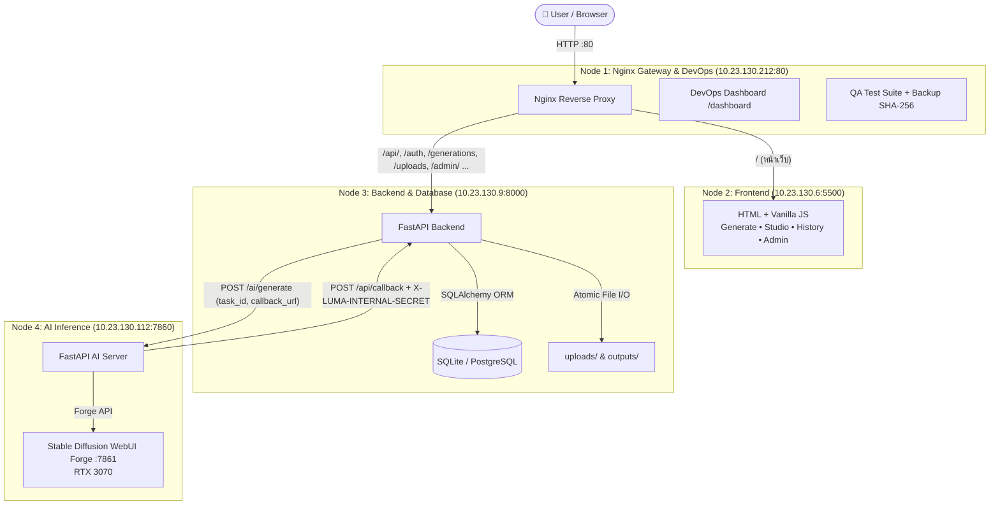
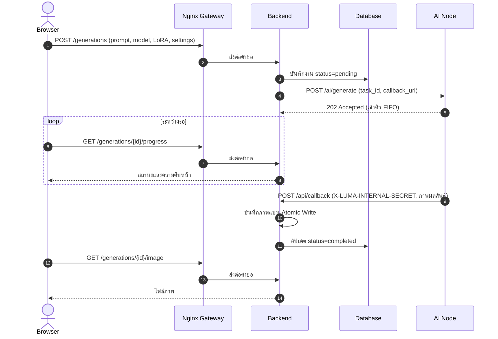
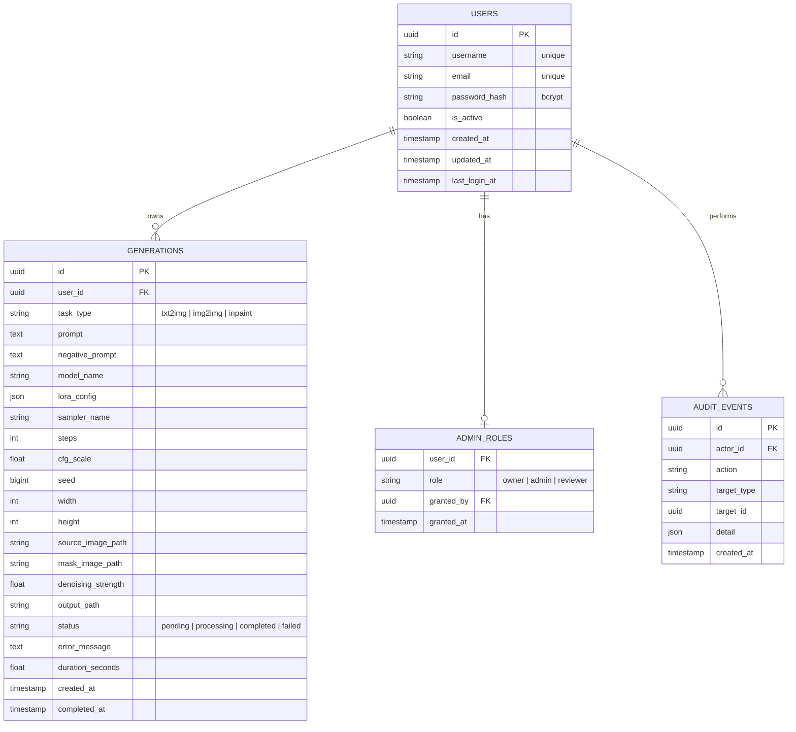

# 🎨 LUMA: Distributed AI Image Generation Platform

**LUMA** เป็นแพลตฟอร์มสร้างและตกแต่งภาพด้วย AI ที่ออกแบบเป็นระบบ **Distributed Computing 4 เครื่อง** เชื่อมกันผ่านวงแลน รองรับ **Text-to-Image (txt2img)**, **Image-to-Image (img2img)**, **Canvas Inpainting** และเครื่องมือ Studio (ตรวจจับท่าทาง, ลายเส้น, Color Splash, ลบพื้นหลัง)

📄 สไลด์นำเสนอโปรเจกต์: [`LUMA_Project_Presentation.pdf`](LUMA_Project_Presentation.pdf)

---

## 🌿 0. โครงสร้าง Repository (แยก Branch ตามเครื่อง)

โค้ดของแต่ละเครื่องอยู่คนละ branch โดย `main` เก็บเฉพาะภาพรวมโปรเจกต์ เอกสาร และสไลด์นำเสนอ

| Branch | เครื่อง | เนื้อหาหลัก | ผู้รับผิดชอบ |
| :--- | :--- | :--- | :---: |
| [`main`](https://github.com/Pongkarm/Project_Luma_PKW/tree/main) | — | README ภาพรวม, `.env.example`, สไลด์นำเสนอ | ทั้งทีม |
| [`devops`](https://github.com/Pongkarm/Project_Luma_PKW/tree/devops) | Node 1: Gateway | `nginx/` (`nginx.conf`, Dashboard, QA Test Suite, Backup, `DEVOPS_MANUAL.md`) | [@bankjunjan](https://github.com/bankjunjan) |
| [`frontend-app`](https://github.com/Pongkarm/Project_Luma_PKW/tree/frontend-app) | Node 2: Frontend | `frontend-html/` (HTML + CSS + Vanilla JS, ชุดทดสอบ `tests/`) | [@winxtxrgit](https://github.com/winxtxrgit) · [@wxnxtxr](https://github.com/wxnxtxr) |
| [`backend`](https://github.com/Pongkarm/Project_Luma_PKW/tree/backend) | Node 3: Backend | `app/` (FastAPI), `tests/` (pytest), Dockerfile, สคริปต์ `run_backend` | [@Pongkarm](https://github.com/Pongkarm) |
| [`ai-node`](https://github.com/Pongkarm/Project_Luma_PKW/tree/ai-node) | Node 4: AI | `ai_server/` (FastAPI + WebUI Forge), LoRA Compatibility Guard | [@Kong19565](https://github.com/Kong19565) |

> แต่ละ branch มี README/คู่มือของตัวเองที่ลงรายละเอียดเฉพาะเครื่องนั้น

---

## 🏛️ 1. Architecture Overview (สถาปัตยกรรมระบบ 4 เครื่อง)

ผู้ใช้เข้าระบบผ่าน Nginx Gateway ที่พอร์ต 80 เพียงจุดเดียว Gateway ส่งต่อหน้าเว็บไปที่ Frontend และส่งคำขอ API ไปที่ Backend ทำให้หน้าเว็บกับ API อยู่ origin เดียวกันและไม่มีปัญหา CORS

### ตารางเครื่องและพอร์ต

| Node | บทบาท | OS | IP | Port | หน้าที่หลัก |
| :---: | :--- | :---: | :---: | :---: | :--- |
| **1** | Nginx Gateway & DevOps | Windows | `10.23.130.212` | `80` | จุดเข้าระบบจุดเดียว, Reverse Proxy, Traffic Log, Dashboard, QA, Backup |
| **2** | Frontend | macOS | `10.23.130.6` | `5500` | หน้าเว็บทั้งหมด รับคำขอเฉพาะที่ผ่าน Gateway (`serve_gateway.py`) |
| **3** | Backend & Database | macOS | `10.23.130.9` | `8000` | Auth (JWT), จัดการงาน, ฐานข้อมูล, เก็บไฟล์ภาพ, Studio Tools, Admin |
| **4** | AI Inference | Windows | `10.23.130.112` | `7860` | รัน Stable Diffusion บน GPU ผ่าน WebUI Forge (`:7861`) พร้อมคิว FIFO |

> 🔒 Nginx อนุญาตเฉพาะเครื่องในวงแลน (`10.23.130.0/24`, `172.20.10.0/24`) และหน้า `/dashboard` เปิดได้จากเครื่อง Gateway เท่านั้น

---

## 🔄 2. ลำดับการสร้างภาพ (Distributed Callback Mode)

Backend สลับโหมดการคุยกับ AI Node ได้ด้วย `AI_MODE` ในไฟล์ `.env` ใช้โหมด Direct (synchronous) ตอนทดสอบบนเครื่องเดียว และใช้โหมด Callback เมื่อรันข้ามเครื่องจริง

---

## ✨ 3. ความสามารถของระบบ

### หน้าเว็บ (Frontend: `frontend-html/`)

| หน้า | ไฟล์ | ใช้ทำอะไร |
| :--- | :--- | :--- |
| หน้าแรก | `index.html` | แนะนำระบบและทางเข้า |
| สมัคร / เข้าสู่ระบบ | `register.html`, `login.html` | สร้างบัญชีและรับ JWT |
| สร้างภาพ | `generate.html` | txt2img, img2img, inpaint (วาด mask บน canvas), เลือก Model และ LoRA, ร่างงานบันทึกอัตโนมัติ |
| Studio | `studio.html` | เครื่องมือแต่งภาพ: Pose, Sketch, Color Splash, Remove Background |
| ประวัติ | `history.html` | ดู ดาวน์โหลด และลบภาพที่เคยสร้าง |
| บัญชี | `account.html` | แก้ไขข้อมูลผู้ใช้ |
| ผู้ดูแลระบบ | `admin.html` | สถิติ, จัดการผู้ใช้, สิทธิ์ admin, Audit Log |

### API หลัก (Backend: `app/api/`)

| กลุ่ม | Endpoint |
| :--- | :--- |
| Auth | `POST /auth/register`, `POST /auth/login`, `GET/PATCH /auth/me` |
| Generations | `POST/GET /generations`, `GET/DELETE /generations/{id}`, `POST /generations/{id}/cancel`, `GET /generations/{id}/progress`, `GET /generations/{id}/image` |
| Uploads | `POST /uploads`, `GET /uploads/{filename}` |
| Models | `GET /api/models` (Checkpoint และ LoRA พร้อม family) |
| Studio Tools | `POST /api/tools/pose`, `/sketch`, `/color-splash`, `/remove-bg`, `GET /api/tools/results/{filename}` |
| Admin | `/admin/me`, `/admin/stats`, `/admin/users`, `/admin/generations`, `/admin/audit`, `/admin/roles` |
| AI Callback | `POST /api/callback` (ต้องมี `X-LUMA-INTERNAL-SECRET`) |
| Health | `GET /healthz` |

### AI Server (`ai_server/`)

`GET /ai/health`, `GET /ai/models`, `POST /ai/generate`, `POST /ai/edit`, `GET /ai/status/{task_id}`

---

## 🧠 4. Model & LoRA Compatibility Guard

LoRA แต่ละตัวเทรนมาสำหรับ Base Model ตระกูลเดียว ถ้าใช้ข้ามตระกูล ภาพจะเพี้ยน ระบบจึงกันไว้ 2 ชั้น

| Family | ตัวอย่าง Checkpoint | LoRA ที่ใช้ได้ |
| :--- | :--- | :--- |
| `sd15` | `counterfeitV30_v30` | `tachi-e`, `niji_and_midj_mix217` |
| `illustrious_xl` | `novaAnimeXL_ilV190` | `SousouNoFrieren`, `Char-Frieren-IL-V1`, `himmel` |
| `pony_xl` | `prefectPonyXL_v6` | `[Artstyle] SomethingWeird_Geekpower [PDXL]` |

1. **Frontend:** รายการ LoRA แสดงเฉพาะตัวที่เข้ากับ Model ที่เลือก ถ้าเปลี่ยน Model แล้ว LoRA เดิมใช้ไม่ได้ จะรีเซ็ตเป็น "ไม่ใช้"
2. **AI Server:** ถ้ามีคำขอข้ามตระกูลส่งตรงมาทาง API ระบบจะตัด LoRA นั้นออก (auto-skip) แล้วบันทึก warning แทนการตอบ error

---

## 🗄️ 5. Database Schema

---

## 🛡️ 6. ความปลอดภัย (Defense-in-Depth)

| ชั้น | อยู่ที่ | รายละเอียด |
| :--- | :--- | :--- |
| LAN Isolation | Gateway | รับเฉพาะ IP ในวงแลน นอกนั้นตอบ 403 |
| Dashboard Whitelist | Gateway | `/dashboard` เปิดได้จากเครื่อง Gateway เท่านั้น |
| Gateway-only Frontend | Frontend | เข้าพอร์ต 5500 ตรงจะได้ 403 ต้องผ่าน Gateway |
| JWT + Bcrypt + Role | Backend | ยืนยันตัวตนทุกคำขอ แยกสิทธิ์ owner / admin / reviewer พร้อม Audit Log |
| 5-Layer Image Validation | Backend | Content-Type → ขนาดไฟล์ ≤ 10MB → Magic Bytes → กัน Decompression Bomb → ลบ EXIF และบันทึกแบบ Atomic |
| Internal Secret | Backend ↔ AI | callback ต้องแนบ `X-LUMA-INTERNAL-SECRET` ที่ตรงกันทั้งสองเครื่อง |

> ⚠️ ค่าใน `.env.example` เป็นตัวอย่างเท่านั้น ต้องสร้าง `SECRET_KEY` และ `AI_CALLBACK_SECRET` ใหม่เองด้วย
> `python -c "import secrets; print(secrets.token_urlsafe(64))"`

---

## 🧪 7. การทดสอบ

| Node | ชุดทดสอบ | จำนวน | วิธีรัน |
| :--- | :--- | :---: | :--- |
| Gateway | `nginx/test_distributed_system.py` / `.ps1` | 12 (Python) / 16 (PowerShell) | `nginx\run_tests.bat` |
| Frontend | `frontend-html/tests/` (unit, e2e, regressions, responsive) | 4 ชุด | `npm run test:all` (Node 22+) |
| Backend | `tests/` (pytest) | 96 | `pytest --cov=app` |
| AI Server | `ai_server/tests/` (pytest) | 18 | `pytest ai_server/tests` |

---

## 🚀 8. วิธีเปิดระบบ

เปิดตามลำดับ **AI → Backend → Frontend → Gateway** แล้วเข้าใช้งานที่ **`http://10.23.130.212`**

| ลำดับ | เครื่อง | Branch | คำสั่ง |
| :---: | :--- | :--- | :--- |
| 1 | AI Node | `ai-node` | `ai_server\start_forge_api.bat` (Forge :7861) แล้วตามด้วย `start_ai_server.bat` (AI Server :7860) |
| 2 | Backend | `backend` | `./run_backend.sh` (macOS/Linux) หรือ `run_backend.bat` (Windows) |
| 3 | Frontend | `frontend-app` | `cd frontend-html && python3 serve_gateway.py` |
| 4 | Gateway | `devops` | `nginx\run_nginx_with_logs.bat` |

ตั้งค่าแต่ละเครื่องโดยคัดลอก `.env.example` เป็น `.env` แล้วแก้ IP และ secret ให้ตรงกัน ส่วนรายละเอียดเพิ่มเติมดูได้จากคู่มือในแต่ละ branch (`DEVOPS_MANUAL.md`, `README-backend.md`, `ai_server/README.md`, `frontend-html/README.md`)

---

## 👥 9. ทีมพัฒนา

| คนที่ | หน้าที่ | GitHub |
| :---: | :--- | :--- |
| 1 | Frontend | [@winxtxrgit](https://github.com/winxtxrgit) · [@wxnxtxr](https://github.com/wxnxtxr) |
| 2 | Backend & Database (เจ้าของ repo) | [@Pongkarm](https://github.com/Pongkarm) |
| 3 | AI Inference | [@Kong19565](https://github.com/Kong19565) |
| 4 | QA / DevOps | [@bankjunjan](https://github.com/bankjunjan) |

🎓 ศูนย์เตรียมสอบปากเปล่า: [kong19565.github.io/luma-defense-mastery](https://kong19565.github.io/luma-defense-mastery/)
