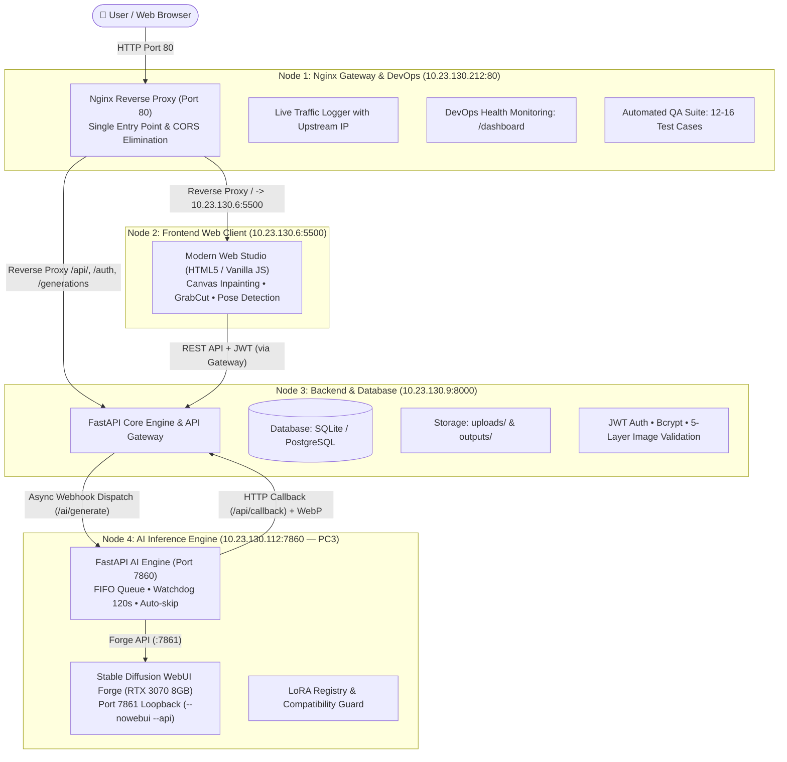
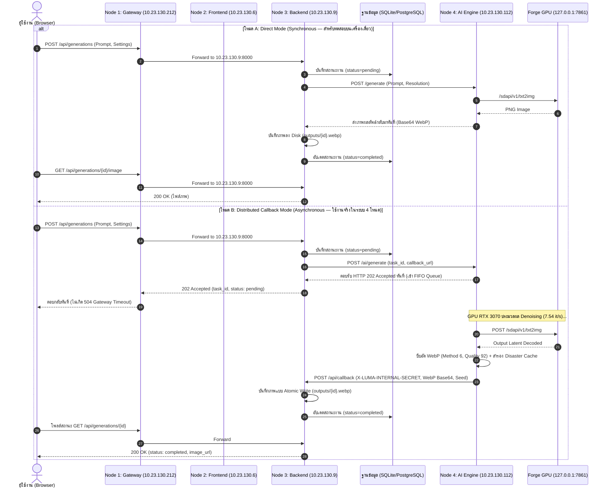
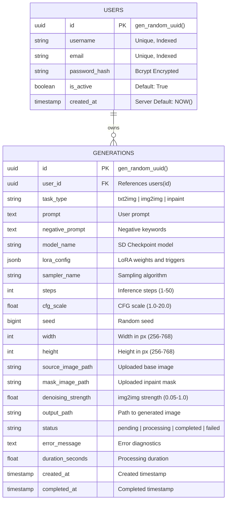

# 🎨 LUMA: Distributed AI Image Generation Platform

[](https://python.org)
[](https://fastapi.tiangolo.com)
[](#-1-architecture-overview-สถาปัตยกรรมระบบ-4-โหนด)
[](http://10.23.130.212)
[-10.23.130.112%3A7860-blueviolet.svg?logo=nvidia)](http://10.23.130.112:7860)
[-brightgreen.svg)](#-6-testing--quality-assurance)
[](#-3-model--lora-architecture-compatibility-ระบบตรวจสอบความเข้ากันได้)

**LUMA** เป็นแพลตฟอร์มสร้างและตัดต่อภาพด้วยปัญญาประดิษฐ์ระดับสตูดิโอ (AI Studio & Image Generation Platform) ที่ออกแบบด้วยสถาปัตยกรรม **Distributed Computing 4 โหนด (4 Physical Nodes)** รองรับการสร้างภาพแบบ Multi-Modal ทั้ง **Text-to-Image (txt2img)**, **Image-to-Image (img2img)**, และ **Canvas Inpainting** พร้อมเครื่องมือประมวลผลภาพขั้นสูงในตัว

---

## 🏛️ 1. Architecture Overview (สถาปัตยกรรมระบบ 4 โหนด)

ระบบแบ่งแยกหน้าที่การทำงานอย่างชัดเจนตามหลักการ Separation of Concerns ออกเป็น **4 Physical Nodes** เชื่อมต่อกันผ่านเครือข่ายวงแลน (Local Area Network):



### ตารางแจกแจงอุปกรณ์และพอร์ตในเครือข่าย (Network & Hardware Matrix)

| Node | เครื่อง / บทบาท | ผู้รับผิดชอบ | ระบบปฏิบัติการ | IP Address | Port | หน้าที่หลัก |
| :---: | :--- | :---: | :---: | :---: | :---: | :--- |
| **1** | **Nginx Gateway & DevOps** | คนที่ 4 (QA / DevOps) | Windows | `10.23.130.212` | `80` | จุดรับ Traffic จุดเดียว (Single Entry Point), Reverse Proxy กระจายงาน, Realtime Log, Monitoring Dashboard, QA Testing, Backup |
| **2** | **Frontend Client** | คนที่ 1 | macOS | `10.23.130.6` | `5500` | บริการหน้าเว็บ UI, Canvas Inpainting Tool, Studio GrabCut, Pose Detection |
| **3** | **Backend & Database** | คนที่ 2 (Pongkarm) | macOS | `10.23.130.9` | `8000` | จัดการ Authentication, บันทึก Task คิว, ฐานข้อมูล, จัดเก็บรูปภาพ, รับ Callback Webhook |
| **4** | **AI Inference Engine** | คนที่ 3 (Apisak K.) | Windows (PC3) | `10.23.130.112` | `7860` | ประมวลผลโมเดล Stable Diffusion บน GPU RTX 3070 8GB, FIFO Queue, LoRA Guard, WebP Compression |
| **-** | **Forge Headless Engine** | โลคอลภายใน Node 4 | Windows (PC3) | `127.0.0.1` | `7861` | เอนจิน Diffusion ทำงานเบื้องหลังผ่าน REST API (`--nowebui --api`) |

---

## 🔄 2. Dual-Mode Inference Strategy (กลยุทธ์การเชื่อมโยงระบบ AI)

Backend รองรับการทำงานร่วมกับ AI Node ใน 2 รูปแบบ สลับได้ผ่านตัวแปรสภาพแวดล้อม `AI_MODE`:



---

## 🧠 3. Model & LoRA Architecture Compatibility (ระบบตรวจสอบความเข้ากันได้)

เนื่องจาก LoRA Adapter แต่ละตัวถูกเทรนขึ้นมาสำหรับ Base Model เฉพาะตระกูล หากนำ LoRA ข้ามรุ่นไปผสม (เช่น นำ LoRA ของ Illustrious XL ไปใช้กับ SD 1.5) ภาพที่ได้จะแตกลายและเกิด Artifacts ผิดเพี้ยน LUMA จึงมีระบบป้องกัน 2 ชั้น (**Defense-in-Depth**):

### ตารางจำแนกตระกูลโมเดล (Model Family Matrix)

| ตระกูลสถาปัตยกรรม (Family) | ตัวอย่าง Checkpoint Model | LoRA Adapter ที่รองรับ |
| :--- | :--- | :--- |
| **`sd15`** (Stable Diffusion 1.5) | `counterfeitV30_v30.safetensors` | `tachi-e`, `niji_and_midj_mix217` |
| **`illustrious_xl`** (Illustrious XL) | `novaAnimeXL_ilV190.safetensors` | `SousouNoFrieren`, `Char-Frieren-IL-V1`, `himmel` |
| **`pony_xl`** (Pony XL) | `prefectPonyXL_v6.safetensors` | `[Artstyle] SomethingWeird_Geekpower [PDXL]` |

### กลไกการป้องกัน 2 ระดับ:
1. **Frontend Level (UI Filter & Auto-Reset)**:
   * หน้าเว็บจะกรอง Dropdown ของ LoRA ให้แสดงเฉพาะตัวที่ตรงกับ Base Model ที่เลือก
   * หากผู้ใช้สลับโมเดลแล้ว LoRA เดิมเข้ากันไม่ได้ ระบบจะรีเซ็ตกลับเป็น `"ไม่ใช้"` และบันทึก Draft อัตโนมัติ ป้องกันความสับสนของผู้ใช้
2. **AI Server Level (Auto-skip Safety Guard)**:
   * กรณีมีคำขอยิงข้ามตระกูลส่งตรงมาทาง API ตัว Server จะไม่ทำให้ Request ล่ม (ไม่ Throw Error 500) แต่จะ **Auto-skip** ตัดแท็ก LoRA นั้นออก พร้อมบันทึก Warning Log เพื่อให้งานสร้างภาพยังคงดำเนินต่อไปได้อย่างปลอดภัย (**Zero Breaking Change**)

---

## 🗄️ 4. Database Schema (โครงสร้างฐานข้อมูล)



---

## 🛡️ 5. Five-Layer Image Security Validation (ระบบความปลอดภัย 5 ชั้น)

เพื่อป้องกันการโจมตีทางไซเบอร์และการส่งไฟล์อันตรายเข้าสู่ GPU ระบบมีระบบคัดกรองไฟล์ภาพที่เข้มงวด 5 ระดับ:

| ลำดับชั้น (Layer) | การตรวจสอบ (Validation Type) | วัตถุประสงค์ในการป้องกัน (Defense Purpose) |
|---|---|---|
| **Layer 1** | Content-Type Header Check | กรองเบื้องต้นเฉพาะ `image/png`, `image/jpeg`, `image/webp` |
| **Layer 2** | File Size Bound (10MB Limit) | ป้องกัน DoS จากไฟล์ขนาดยักษ์ (ตอบกลับ HTTP 413) |
| **Layer 3** | Magic Bytes Deep Inspection | ตรวจสอบ Header ไบนารีแท้จริง ป้องกันมัลแวร์ที่เปลี่ยนนามสกุลไฟล์หลอก (HTTP 422) |
| **Layer 4** | Decompression Bomb Defense | ควบคุม `Image.MAX_IMAGE_PIXELS = 16M` (4096×4096px) ตามมาตรฐาน OWASP |
| **Layer 5** | EXIF Stripping & Atomic Write | ลบพิกัด GPS/ข้อมูลส่วนบุคคลออกจากภาพ และบันทึกไฟล์แบบ Atomic ป้องกันไฟล์เสียหาย |

---

## 🧪 6. Testing & Quality Assurance (ผลการทดสอบเต็มระบบ)

ระบบผ่านการทดสอบแบบอัตโนมัติ (Automated Tests) ครบถ้วนทุกชั้นสถาปัตยกรรมทั้ง 4 โหนด:

* **Node 1 DevOps Gateway (`nginx/test_distributed_system.py`)**: ผ่านการทดสอบ **12/12 Tests (100% Pass)** ครอบคลุม Routing, Reverse Proxy, Upstream IP Whitelist, Data Ingestion, Image Validation และ Backup Integrity
* **Node 2 Frontend (`frontend-html`)**: ผ่านการทดสอบ **14/14 Tests** ครอบคลุมการคำนวณขนาดภาพ, กฎรหัสผ่าน, และการกรอง LoRA ตามตระกูลโมเดล
* **Node 3 Backend Core (`backend_node`)**: ผ่านการทดสอบ **83+ Integration Tests** ครอบคลุม Auth, Permissions, Upload Security, และ Webhook Idempotency
* **Node 4 AI Inference Node (`Project_Luma_PKW` / `ai_server`)**: ผ่านการทดสอบ **17/17 Tests (100% Pass)**
  * `test_server.py`: **9/9 Passed** (GPU Monitor, Models List, LoRA Trigger, Task Lifecycle, VRAM Guard)
  * `test_edge_cases.py`: **8/8 Passed** (Bounds Sanitization, Empty Prompt, HTTP 403 Security, Cancellation)
* **Multi-Node Full Pipeline (`test_multi_node_e2e.py`)**: ผ่านการทดสอบจำลองเชื่อมโยง 4 โหนดพร้อมกันแบบครบวงจรข้ามวงแลน

---

## 🚀 7. Quick Start Guide (วิธีเปิดใช้งานระบบในวงแลน)

### 1) รัน Node 4: AI Inference Server (พอร์ต 7860 — เครื่อง PC3)
ดับเบิลคลิกไฟล์ **`start_ai_server.bat`** (One-Click Launcher) หรือรันผ่าน Terminal:
```powershell
# ในโฟลเดอร์ Project_Luma_PKW หรือ Project_Luma
python -m ai_server.run
```
*(ระบบจะผูกเข้ากับ `0.0.0.0:7860` และเชื่อมต่อกับ Forge Headless บน `127.0.0.1:7861` อัตโนมัติ)*

### 2) รัน Node 3: Backend Core API (พอร์ต 8000 — เครื่อง Pongkarm)
```powershell
# ในโฟลเดอร์ backend_node
uvicorn main:app --host 0.0.0.0 --port 8000 --reload
```

### 3) รัน Node 2: Web Frontend (พอร์ต 5500)
```bash
# ในโฟลเดอร์ frontend_node/frontend-html
python serve_gateway.py
# หรือ python -m http.server 5500
```

### 4) รัน Node 1: Nginx Gateway & DevOps (พอร์ต 80)
ดับเบิลคลิกไฟล์:
```text
nginx\run_nginx_with_logs.bat
```

---

## 🎬 8. Live Demonstration Flow (ลำดับการนำเสนอโปรเจกต์)

1. **เข้าใช้งานผ่าน Single Entry Point:** เปิดเบราว์เซอร์ไปที่ **`http://10.23.130.212/`** (หน้า Gateway พอร์ต 80) โชว์ว่าโหลด UI จาก Node 2 ได้อย่างสมบูรณ์แบบโดยไม่ต้องระบุพอร์ต
2. **มอนิเตอร์สถานะระบบ:** เปิด **`http://10.23.130.212/dashboard`** แสดง Health Status และ VRAM ของทั้ง 4 โหนดแบบ Real-time
3. **ทดสอบ Model & LoRA Filtering:**
   * เลือกโมเดล **Counterfeit v3.0 (SD 1.5)** ➔ สังเกตว่าช่อง LoRA จะแสดงเฉพาะ Tachi-e และ Niji Mix
   * สลับไปเลือก **Nova Anime XL** ➔ สังเกตว่าตัวเลือก LoRA เปลี่ยนเป็น Frieren และ Himmel ทันที
4. **ทดสอบสร้างภาพ (txt2img Asynchronous Flow):**
   * กรอก Prompt ➔ กดสร้างภาพ ➔ Backend ตอบรับ `202 Accepted` ทันที
   * สังเกตหน้าต่าง AI Node Console ประมวลผลบน GPU RTX 3070 ด้วยความเร็ว ~7.54 it/s
   * เมื่อเสร็จสิ้น AI Node ส่ง Callback WebP กลับไปยัง Backend ➔ หน้าเว็บแสดงภาพสำเร็จ
5. **ทดสอบ Inpainting & Image Edit:** อัปโหลดภาพต้นฉบับ ➔ ระบาย Mask สีบนแคนวาส ➔ สั่ง Inpaint แปลงวัตถุเฉพาะจุด
6. **ทดสอบเครื่องมือสตูดิโอ (Studio Tools):** ทดสอบการตรวจจับท่าทาง (Pose Detection) และการตัดพื้นหลัง (GrabCut)
7. **รัน Automated QA Verification:** ดับเบิลคลิก `nginx/run_tests.bat` โชว์ผลการทดสอบผ่าน 100% Pass ยืนยันความพร้อมของระบบ
